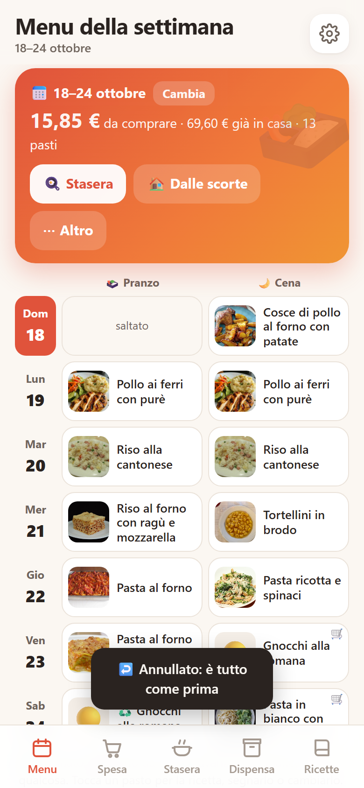
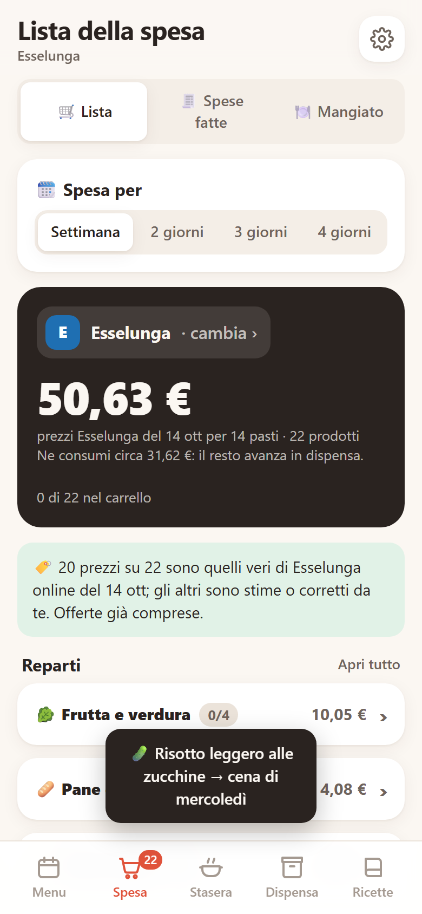
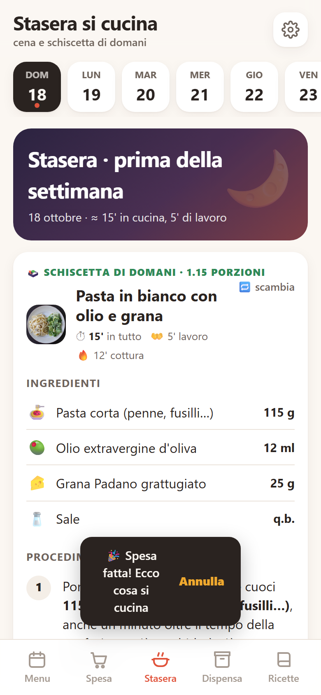
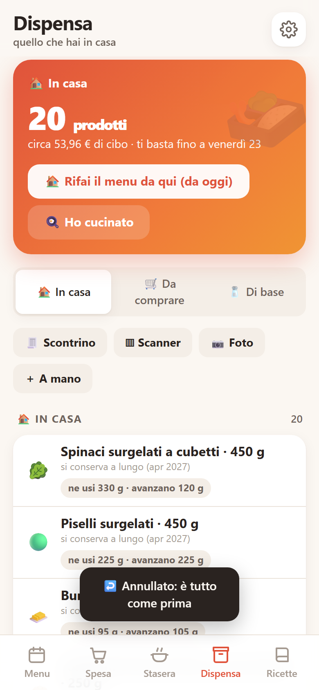

# 🍱 Schiscetta

**Il menu della settimana, la spesa giusta e la cena di stasera, in un'unica app.**
Scegli (o fatti proporre) pranzo e cena per 7 giorni, ottieni la lista della spesa con confezioni vere e prezzi
del tuo supermercato, e la sera trovi la ricetta passo passo con le dosi già calcolate. Pensata per chi si porta il
pranzo al lavoro in *schiscetta* (la "gavetta" milanese) e vuole spendere poco senza buttare niente.

### ▶️ [Provala subito nel browser](https://charles1812.github.io/schiscetta/)

Non devi installare né scaricare niente: si apre dal telefono o dal computer. I dati restano nel tuo browser.
Su Android esiste anche come app vera, con notifiche, timer e lettura dei pagamenti (vedi [Android](#android)).

<p align="center">
  
  
  
  
</p>

## Cosa fa

| | |
|---|---|
| 📅 **Menu** | Un calendario: una riga per giorno, pranzo e cena con la foto del piatto. Scegli tu, oppure «Componi tu il menu» per una settimana varia che riusa le stesse confezioni. Tocca un pasto per la ricetta, cambiarlo, scambiarlo o saltarlo. |
| 🛒 **Spesa** | Lista per reparto con le **confezioni vere** da comprare (non «137 g di riso», ma «1 pacco da 1 kg»), quanto ti serve, quanto avanza e il totale alla cassa. Condivisibile. Lo storico delle spese fatte e di quello che hai mangiato. |
| 🍳 **Stasera** | La cena e la schiscetta di domani con le dosi già moltiplicate, l'ordine in cui farle, passi da spuntare e timer. |
| 🏠 **Dispensa** | Quello che hai in casa con le scadenze, quello da comprare e le cose di base (sale, olio, dado…). «Rifai il menu da qui» costruisce i prossimi giorni **solo con quello che hai**, finché basta. |
| 📖 **Ricette** | 240 piatti facili scritti passo passo, con dosi a persona, tempi (in tutto / di lavoro / di cottura), calorie e costo. Puoi aggiungere le tue. |

### Le idee dietro

- **Niente spreco.** Il menu automatico sceglie piatti che finiscono le confezioni aperte, mette all'inizio della
  settimana i freschi che durano poco e propone gli avanzi della cena come pranzo del giorno dopo.
- **Porzioni vere.** Le dosi partono da quelle a persona e si adattano a chi mangia (anche famiglie, con
  pranzi diversi per ognuno); le porzioni non diventano mai più piccole del necessario.
- **La spesa già fatta conta.** Fotografi lo scontrino, usi lo scanner dei codici a barre o aggiungi a mano: la
  dispensa si riempie e il menu si adatta. Nessun acquisto per ogni pasto: compri quando serve davvero.
- **La vita reale.** «L'ho cucinato così», «con altre dosi» o «ho mangiato altro»: l'app toglie dalla dispensa
  quello che hai usato davvero, mette gli avanzi nei pasti successivi e rifà solo i giorni che non tornano più.
  Ogni cosa si annulla o si corregge.
- **Prezzi credibili.** 16 catene italiane con un indice di prezzo; per Esselunga e Carrefour prezzi reali per
  marca, aggiornabili con uno script. Tocca un prezzo per correggerlo: l'app lo ricorda.

### Funzioni opzionali

- **Lettura dello scontrino con Claude** (Anthropic): righe, sconti e totale aggiornano prezzi e dispensa.
  Serve una tua chiave API, che resta solo sul dispositivo (Impostazioni).
- **Foto della spesa / di una ricetta**: riconosce i prodotti o trascrive la ricetta (stessa chiave).
- **Scanner dei codici a barre** con i dati di Open Food Facts.

## Come provarla

- **Nel browser**: [charles1812.github.io/schiscetta](https://charles1812.github.io/schiscetta/). È la stessa app
  di Android in un unico file HTML; tutto funziona offline tranne scanner, foto e scontrino (che chiedono rete).
- **Dal codice**, con Python 3:

  ```bash
  python tools/build.py          # crea dist/schiscetta.html: aprilo nel browser
  python tools/validate.py       # controlla piatti e ingredienti
  ```

## Come è fatta

Nessun framework, nessun bundler: HTML, CSS e JavaScript a mano, con i dati in JSON. `tools/build.py` mette
tutto in un unico file (`dist/schiscetta.html`) che funziona da solo; l'app Android è una WebView che carica quel file
e aggiunge notifiche, timer e qualche ponte verso il sistema.

| Percorso | Cosa c'è |
|---|---|
| `web/` | l'app: `index.html`, `style.css`, `app.js` (stato in `localStorage`) |
| `data/piatti.json` | i piatti: ingredienti con dosi a persona, tempi, tipo, adatto alla schiscetta |
| `data/ricette/*.json` | i passaggi dettagliati, con segnaposto come `{riso}` che diventano «160 g di riso» |
| `data/ingredienti.json` | ingredienti: reparto, confezione, prezzo, durata, valori nutrizionali |
| `data/supermercati.json` | catene e indice dei prezzi |
| `data/prezzi/` | prezzi reali per marca (Esselunga, Carrefour, Pam) |
| `tools/build.py` | costruisce il file unico |
| `tools/validate.py` | controlla lo schema dei dati (tempi coerenti, dosi a persona, niente quantità fisse nei passi) |
| `tools/test_app.py` | test end-to-end con Playwright e screenshot |
| `tools/prezzi.py` | legge i prezzi pubblici di Esselunga/Carrefour (richieste lente, rispetta robots.txt, niente login) |
| `tools/build_apk.py` | APK firmato senza Gradle (serve l'SDK Android) |
| `android/` | la WebView Java: notifiche, timer, aggiornamenti, Google Wallet |

### Test

```bash
pip install playwright && playwright install chromium
python tools/build.py && python tools/test_app.py
```

## Android

`python tools/build_apk.py --bump` crea `dist/schiscetta.apk`. La prima volta genera una chiave di firma in
`android/keystore/` (esclusa da git: tienine una copia, senza la stessa chiave gli aggiornamenti non si installano).
Gli aggiornamenti dentro l'app leggono un `versione.json` da un indirizzo che imposti tu (`UPD_URL` in `web/app.js`);
la ricerca nel catalogo completo dei supermercati usa un piccolo server PHP (`API`), non incluso in questo repository.

---

Progetto personale nato per uso quotidiano; le ricette sono pensate per la cucina di casa italiana.
